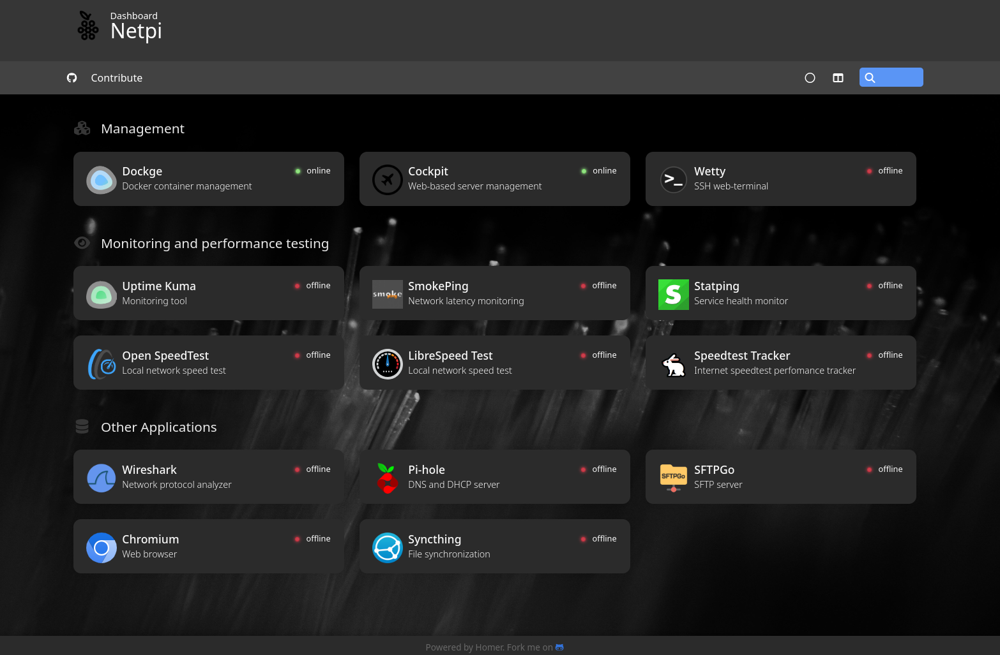

<p align="center"></p>
<h1 align="center">Netpi</h1>
<p align="center"><b>Simplify network diagnostic and troubleshooting with a Raspberry Pi powered toolkit</b></p> 

> [!NOTE]
> Personal project, built with AI coding agents under my supervision. Review the code carefully before you use it.



# Table of Contents

- [Purpose](#purpose)
- [Requirements](#requirements)
- [Installation](#installation)
- [Usage](#usage)
- [Contributing](#contributing)
- [Acknowledgments](#acknowledgments)

# Purpose
Netpi is an Ansible based automation script designed to simplify the installation of essential network troubleshooting tools on Ubuntu Linux hosts. Intended for Raspberry Pi's, Netpi provides a [comprehensive suite](docs/tools.md) of CLI tools and Docker containers, all accessible through a custom dashboard, making network diagnostics and troubleshooting efficient and user-friendly.

# Requirements
The Raspberry Pi served as the inspiration for this project due to its compact form factor and widespread adoption. However, the project can be installed on any host running Ubuntu.
The project has been tested and verified on the following Raspberry Pi model and Ubuntu versions:

Raspberry Pi:
- Raspberry Pi 4 (4 GB RAM version)

Ubuntu:
- Ubuntu Server 22.04 LTS
- Ubuntu Server 24.04 LTS

# Installation
The installation script performs the following actions:

1. Installs Ansible from the official PPA
2. Runs an Ansible playbook locally

The Ansible playbook executes the following tasks:

1. Updates the system packages
2. Installs all necessary CLI tools
3. Installs Docker and Docker Compose
4. Creates systemd scripts that dynamically read and store the IP address of the Host for the dashboard
5. Activates automatic system package updates, if enabled in the configuration
6. Creates a folder for Docker services under /opt
7. Copies all Docker Compose files into the newly created folder

## Configuration
Before running the setup script, copy the example configuration file and customize it:
```
cp example-config.yml config.yml
```
Then review and edit `config.yml` as needed. This file contains essential configuration parameters for the installation process. Adjust the settings according to your personal preferences and requirements.

## Installation Steps
The script must be executed locally on the target host.

1. Clone the Netpi repository to the target host:
```
git clone https://github.com/SG303/netpi.git
```
2. Navigate to the cloned directory:
```
cd netpi
```
3. Copy the example configuration file and edit it:
```
cp example-config.yml config.yml
nano config.yml
```
4. Make the *setup.sh* script executable
```
chmod +x setup.sh
```
5. Run the setup script
```
./setup.sh
```
6. Once the playbook execution is complete, access the Netpi dashboard by navigating to your Raspberry Pi's IP address in a web browser. The dashboard is running on http port 80.


# Usage
The Docker container services can be accessed via the dashboard. By default, only the dashboard and Dockge container are initially started. Dockge is a Docker container management software. Additional containers can be launched either through Dockge or directly via the command-line interface.

The installed CLI tools can be used normally through the host's command line. Additionally, the web-based terminal tool "Wetty," which is accessible from the dashboard, allows direct access to the host's CLI through a web browser.

A list of all the installed tools and containers can be found [here](docs/tools.md).

The Docker containers work out of the box. Depending on the use case, some changes may need to be made to the Docker Compose files.

For instructions on using the individual tools, please refer to their respective project documentation.

## Graylog

### Credentials
Graylog's secrets are not stored in the repository. On the first run, the setup playbook generates them and writes them to `/opt/docker/graylog/.env` (mode `0600`):

- `GRAYLOG_PASSWORD_SECRET`: a random 96-character pepper
- `GRAYLOG_ROOT_PASSWORD_SHA2`: the SHA256 hash of a random password for the `admin` user
- `OPENSEARCH_INITIAL_ADMIN_PASSWORD`: required by the OpenSearch image. It is not used for logins because the OpenSearch security plugin is disabled.

The playbook never overwrites an existing `.env`, so running it again keeps your secrets.

To show the `admin` password:
```
sudo cat /etc/netpi/graylog_admin_password
```

To change the `admin` password:
```
cd /opt/docker/graylog
NEW_HASH=$(read -rsp 'New password: ' pw; echo -n "$pw" | sha256sum | cut -d' ' -f1)
sed -i "s/^GRAYLOG_ROOT_PASSWORD_SHA2=.*/GRAYLOG_ROOT_PASSWORD_SHA2=$NEW_HASH/" .env
docker compose up -d
```
After the change, `/etc/netpi/graylog_admin_password` no longer matches. Delete it, or update it yourself.

Do not change `GRAYLOG_PASSWORD_SECRET` after the first start. Graylog uses it to encrypt stored secrets, such as input credentials.

To set up Graylog by hand without the playbook, copy `docker/graylog/.env.example` to `.env` and fill in the values. The comments in the file explain how to generate each one.

### Upgrading existing installations (Graylog 6.3 → 7.2)
Existing installations that ran Graylog before this change used the insecure defaults (`admin`/`admin` and the placeholder secret). Do the following steps by hand on such a host:

1. Back up the Docker volumes (`mongo_data`, `os_data`, `graylog_data`).
2. Create `/opt/docker/graylog/.env` before you run the playbook again. Otherwise the playbook generates a new `GRAYLOG_PASSWORD_SECRET`, and secrets encrypted with the old value (such as input credentials) can no longer be read. You have two options:
   - Keep `GRAYLOG_PASSWORD_SECRET=somepasswordpepper` and set a new `GRAYLOG_ROOT_PASSWORD_SHA2`. Nothing breaks, but the pepper stays weak.
   - Set a new random secret and re-enter any input credentials afterwards.
3. Upgrade through every minor version, as Graylog requires. Change the `graylog/graylog` tag in `docker-compose.yml` step by step, run `docker compose up -d` each time, and wait until Graylog is fully up before you start the next step:
   `6.3` → `7.0` → `7.1` → `7.2`
4. Keep MongoDB 7.0 and OpenSearch 2.19.6. Graylog 7.0, 7.1 and 7.2 all support both. Graylog 7.0 and 7.1 do not support OpenSearch 3.x. Graylog 7.2 supports OpenSearch up to 3.7.x, but that upgrade is one-way, and it is only possible if no index was created before OpenSearch 2.0.

See the [Graylog upgrade guide](https://go2docs.graylog.org/current/upgrading_graylog/upgrading_graylog.html) and the [compatibility matrix](https://go2docs.graylog.org/current/downloading_and_installing_graylog/compatibility_matrix.htm).

## Uptime Kuma 2
Uptime Kuma is now pinned to major version `2`. Before this change, the `latest` tag still pointed to version 1. When an existing version 1 installation starts version 2 for the first time, Uptime Kuma migrates the database. With a lot of monitoring history, this can take a while. Do not stop the container during the migration. You cannot go back to version 1 afterwards, so back up `./data` first.

## Image versions
Images are pinned to a major version wherever the image publishes one. Dependabot (`.github/dependabot.yml`) suggests updates every week. Some images still use `latest` because they do not publish major-version tags: the linuxserver.io images, Pi-hole, Homer, CORSair, OpenSpeedTest and ntopng.

# Contributing

Contributions to enhance Netpi's functionality and usability are welcome. To contribute, please follow these steps:
1. Fork the repository
2. Create a new branch for your feature or bug fix
3. Commit your changes and push the branch to your fork
4. Submit a pull request detailing your changes

# Acknowledgments
Thanks go to the open-source community for developing and maintaining [the incredible tools and utilities](docs/tools.md) that make Netpi possible.

# Status

Personal project, built with AI coding agents under my supervision. There is
no support and no stability guarantee; review the code carefully before you
rely on it. See [LICENSE](LICENSE) for the warranty terms.
